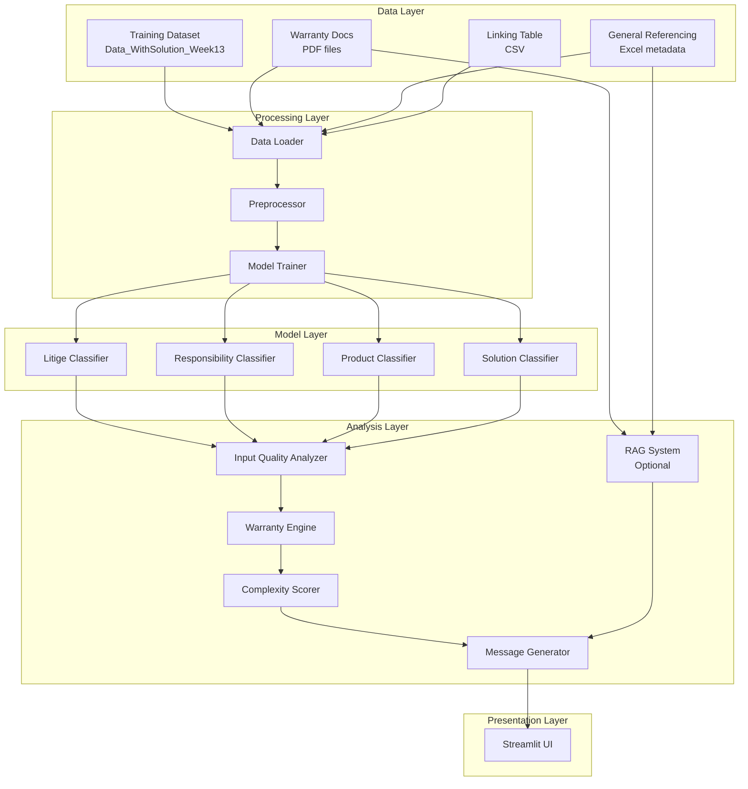
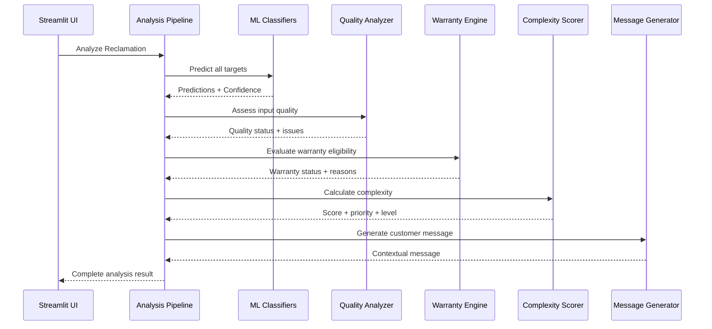

# Design Document - SAV Copilot

## Overview

The SAV Copilot is a machine learning-powered decision support system for after-sales service operators at Atlantem/HERIGE. The system provides automated pre-qualification of customer complaints by analyzing complaint text and attachments to predict dispute type, responsibility, product details, and recommended solutions. It combines supervised classification models with rule-based warranty assessment and complexity scoring to accelerate case processing.

**Key Design Goals:**
- **Speed**: Analyze complaints in under 2 seconds for real-time operator support
- **Transparency**: Provide confidence scores and reasoning for all predictions
- **Robustness**: Handle incomplete or poor-quality inputs gracefully
- **Simplicity**: Hackathon MVP with minimal dependencies and clear code structure
- **Modularity**: Separate concerns for easy modification and demonstration

**Technology Stack:**
- **ML Framework**: scikit-learn (TF-IDF + LogisticRegression)
- **Model Persistence**: joblib
- **UI Framework**: Streamlit
- **Data Processing**: pandas, numpy
- **Optional RAG**: TF-IDF-based document retrieval (no vector DB required)

## Architecture

### High-Level Architecture



### Component Interaction Flow



## Components and Interfaces

### 1. Data Loader Module

**Responsibility**: Load and integrate all data sources into a unified dataset.

**Interface**:
```python
class DataLoader:
    def load_training_data(self, path: str) -> pd.DataFrame:
        """Load reclamations with solutions from Excel."""
        
    def load_warranty_docs(self, path: str) -> List[Dict[str, str]]:
        """Load warranty PDF documents and extract text."""
        
    def load_general_referencing(self, path: str) -> pd.DataFrame:
        """Load metadata and category definitions."""
        
    def load_linking_table(self, path: str) -> pd.DataFrame:
        """Load reclamation-attachment mapping."""
        
    def merge_attachments(self, reclamations: pd.DataFrame, 
                         linking: pd.DataFrame) -> pd.DataFrame:
        """Merge attachment references with reclamations."""
```

**Key Design Decisions**:
- Use pandas for tabular data (Excel, CSV)
- Use PyPDF2 or pdfplumber for PDF text extraction
- Implement flexible column matching for schema variations
- Log errors but continue with available data (graceful degradation)

### 2. Preprocessor Module

**Responsibility**: Clean and normalize text data for ML models.

**Interface**:
```python
class Preprocessor:
    def normalize_text(self, text: str) -> str:
        """Remove extra whitespace, standardize encoding."""
        
    def handle_missing_values(self, df: pd.DataFrame) -> pd.DataFrame:
        """Fill or flag missing values appropriately."""
        
    def extract_features(self, df: pd.DataFrame, 
                        text_column: str) -> pd.DataFrame:
        """Prepare text features for TF-IDF."""
        
    def flexible_column_match(self, df: pd.DataFrame, 
                             expected_cols: List[str]) -> Dict[str, str]:
        """Map actual columns to expected schema."""
```

**Key Design Decisions**:
- Preserve original data in separate columns for traceability
- Use simple string operations (strip, lower, regex) for normalization
- Handle French text encoding (UTF-8)
- Non-critical missing values filled with empty string or "unknown"

### 3. Model Trainer Module

**Responsibility**: Train separate classifiers for each prediction target.

**Interface**:
```python
class ModelTrainer:
    def __init__(self, models_dir: str = "models"):
        self.models_dir = models_dir
        self.vectorizers = {}
        self.classifiers = {}
        
    def train_classifier(self, X: pd.Series, y: pd.Series, 
                        target_name: str) -> Tuple[TfidfVectorizer, LogisticRegression]:
        """Train TF-IDF + LogisticRegression for one target."""
        
    def train_all(self, df: pd.DataFrame, 
                 text_column: str,
                 target_columns: List[str]) -> None:
        """Train classifiers for all targets."""
        
    def save_models(self) -> None:
        """Persist all models to disk using joblib."""
        
    def load_models(self) -> bool:
        """Load existing models from disk. Returns True if successful."""
```

**Key Design Decisions**:
- Use TfidfVectorizer with default parameters (can tune later)
- Use LogisticRegression with multi_class='ovr' for multiclass
- Train separate model per target (litige, responsibility, product, solution)
- Save vectorizer + classifier pairs together
- Include metadata (training date, class counts) in saved files

**TF-IDF Configuration**:
```python
TfidfVectorizer(
    max_features=5000,  # Limit vocabulary size
    ngram_range=(1, 2),  # Unigrams and bigrams
    min_df=2,  # Ignore very rare terms
    sublinear_tf=True  # Use log scaling for term frequency
)
```

**LogisticRegression Configuration**:
```python
LogisticRegression(
    max_iter=1000,  # Ensure convergence
    multi_class='ovr',  # One-vs-rest for multiclass
    solver='lbfgs',  # Efficient for small-medium datasets
    random_state=42  # Reproducibility
)
```

### 4. Prediction Module

**Responsibility**: Generate predictions with confidence scores for new complaints.

**Interface**:
```python
class Predictor:
    def __init__(self, trainer: ModelTrainer):
        self.trainer = trainer
        
    def predict_single(self, text: str, target: str) -> Dict[str, Any]:
        """Predict one target with confidence score."""
        
    def predict_top_k(self, text: str, target: str, k: int = 3) -> List[Dict[str, Any]]:
        """Get top K predictions with confidence scores."""
        
    def predict_all(self, text: str) -> Dict[str, Any]:
        """Predict all targets (litige, responsibility, product, solution)."""
```

**Output Format**:
```python
{
    "litige_type": {
        "prediction": "Défaut de fabrication",
        "confidence": 0.87
    },
    "responsibility": {
        "prediction": "Fabricant",
        "confidence": 0.72
    },
    "product_detail": {
        "prediction": "Portail coulissant",
        "confidence": 0.65
    },
    "solution": {
        "prediction": "Remplacement pièce",
        "confidence": 0.81,
        "top_3": [
            {"label": "Remplacement pièce", "confidence": 0.81},
            {"label": "Réparation sur site", "confidence": 0.12},
            {"label": "Remboursement", "confidence": 0.05}
        ]
    }
}
```

### 5. Input Quality Analyzer

**Responsibility**: Assess the quality and completeness of input data.

**Interface**:
```python
class InputQualityAnalyzer:
    def analyze(self, reclamation: Dict[str, Any]) -> Dict[str, Any]:
        """Analyze input quality and return status + issues."""
        
    def check_description_length(self, text: str) -> Optional[str]:
        """Flag if description is too short."""
        
    def check_attachments(self, attachments: List[str]) -> Optional[str]:
        """Flag if attachments are missing."""
        
    def check_vagueness(self, text: str) -> Optional[str]:
        """Flag if description is too vague."""
```

**Quality Rules**:
- **too_short**: Description < 20 characters
- **missing_attachments**: No attached files
- **too_vague**: Fewer than 5 meaningful words (excluding stop words)

**Output Format**:
```python
{
    "status": "usable" | "poor" | "unusable",
    "issues": [
        "too_short",
        "missing_attachments"
    ],
    "details": {
        "description_length": 15,
        "attachment_count": 0,
        "meaningful_word_count": 3
    }
}
```

### 6. Warranty Engine

**Responsibility**: Assess probable warranty eligibility using business rules.

**Interface**:
```python
class WarrantyEngine:
    def __init__(self):
        self.exclusion_patterns = self._load_exclusion_patterns()
        
    def evaluate(self, reclamation_text: str, 
                product_type: str) -> Dict[str, Any]:
        """Evaluate warranty eligibility based on text patterns."""
        
    def _load_exclusion_patterns(self) -> Dict[str, List[str]]:
        """Load warranty exclusion keyword patterns."""
```

**Exclusion Categories** (from requirements):
1. **Normal wear/aging**: "usure normale", "vieillissement", "décoloration naturelle"
2. **Poor maintenance**: "mauvais entretien", "installation non conforme", "défaut d'entretien"
3. **Handling damage**: "choc", "rayure", "dommage de manipulation"
4. **Aggressive environment**: "environnement agressif", "bord de mer", "corrosion"
5. **Hardware/accessories**: "quincaillerie", "accessoires", "moteur", "électronique"

**Output Format**:
```python
{
    "status": "hors_garantie_probable" | "incertaine" | "eligible_probable",
    "reasons": [
        "Mention d'usure normale détectée",
        "Environnement agressif mentionné"
    ],
    "matched_patterns": {
        "normal_wear": ["usure"],
        "aggressive_environment": ["bord de mer"]
    },
    "disclaimer": "Cette évaluation est indicative et ne constitue pas une décision légale."
}
```

### 7. Complexity Scorer

**Responsibility**: Calculate complexity score and assign priority level.

**Interface**:
```python
class ComplexityScorer:
    def calculate(self, analysis_result: Dict[str, Any]) -> Dict[str, Any]:
        """Calculate complexity score and assign priority."""
        
    def _score_data_quality(self, quality: Dict) -> int:
        """Score based on input quality."""
        
    def _score_predictions(self, predictions: Dict) -> int:
        """Score based on prediction confidence."""
        
    def _score_warranty(self, warranty: Dict) -> int:
        """Score based on warranty uncertainty."""
```

**Scoring Rules** (from requirements):
- +2: Important data missing
- +1: Multiple attachments present
- +2: Warranty status is "incertaine"
- +1: Solution confidence < 0.5
- +1: Responsibility confidence < 0.5
- -1: Solution confidence > 0.8
- -1: Case is very clear (all confidences > 0.8)
- +1: Contradictory signals detected
- +1: Input quality is "poor"

**Priority Assignment**:
- Score ≤ 1: **quick_win** (rapide)
- Score 2-3: **standard_review** (standard)
- Score ≥ 4: **expert_review** (complexe)

**Output Format**:
```python
{
    "score": 3,
    "level": "standard",
    "priority": "standard_review",
    "breakdown": {
        "data_quality": 1,
        "prediction_confidence": 1,
        "warranty_uncertainty": 2,
        "clarity_bonus": -1
    }
}
```

### 8. Message Generator

**Responsibility**: Generate contextual customer messages based on analysis.

**Interface**:
```python
class MessageGenerator:
    def generate(self, analysis_result: Dict[str, Any]) -> Optional[str]:
        """Generate appropriate customer message."""
        
    def _need_more_info_message(self, quality_issues: List[str]) -> str:
        """Message requesting additional information."""
        
    def _warranty_not_applicable_message(self, reasons: List[str]) -> str:
        """Message about probable warranty exclusion."""
        
    def _reassurance_fast_case_message(self) -> str:
        """Message for quick-win cases."""
```

**Message Templates** (in French):

**need_more_info**:
```
Bonjour,

Nous avons bien reçu votre réclamation. Pour traiter votre dossier efficacement, 
nous aurions besoin de quelques informations complémentaires :

{specific_requests}

Merci de nous fournir ces éléments pour que nous puissions vous aider au mieux.

Cordialement,
Service Après-Vente
```

**warranty_not_applicable**:
```
Bonjour,

Nous avons examiné votre réclamation. D'après les informations fournies, 
il semble que votre situation pourrait ne pas être couverte par la garantie 
pour les raisons suivantes :

{reasons}

Nous vous invitons à consulter les conditions de garantie ou à nous contacter 
pour plus de précisions.

Cordialement,
Service Après-Vente
```

**reassurance_fast_case**:
```
Bonjour,

Nous avons bien reçu votre réclamation et nous vous remercions pour les 
informations fournies. Votre dossier est clair et nous allons le traiter 
rapidement.

Nous reviendrons vers vous sous peu avec une solution.

Cordialement,
Service Après-Vente
```

### 9. RAG System (Optional)

**Responsibility**: Retrieve relevant warranty documentation passages.

**Interface**:
```python
class SimpleRAG:
    def __init__(self, documents: List[Dict[str, str]]):
        self.documents = documents
        self.vectorizer = TfidfVectorizer()
        self.doc_vectors = None
        self._build_index()
        
    def _build_index(self) -> None:
        """Build TF-IDF index for documents."""
        
    def retrieve(self, query: str, top_k: int = 3) -> List[Dict[str, Any]]:
        """Retrieve top K relevant document passages."""
```

**Implementation Approach**:
- Use TF-IDF vectorization for both documents and queries
- Calculate cosine similarity between query and all documents
- Return top K most similar passages
- No external vector database required (in-memory)

**Output Format**:
```python
[
    {
        "source": "GARANTIES CHARUEL 2023.V3.pdf",
        "passage": "Les défauts d'aspect liés à l'usure normale...",
        "similarity": 0.78,
        "page": 3
    },
    ...
]
```

### 10. Streamlit UI

**Responsibility**: Provide interactive web interface for demonstrations.

**Interface Structure**:
```python
# app.py
def main():
    st.title("SAV Copilot - Aide à la Décision")
    
    # Sidebar: Configuration
    with st.sidebar:
        display_config_options()
    
    # Main area: Input
    reclamation = get_reclamation_input()
    
    # Analysis button
    if st.button("Analyser"):
        with st.spinner("Analyse en cours..."):
            result = analyze_reclamation(reclamation)
            display_results(result)

def display_results(result: Dict[str, Any]):
    # Predictions section
    display_predictions(result["predictions"])
    
    # Quality assessment
    display_quality(result["quality"])
    
    # Warranty evaluation
    display_warranty(result["warranty"])
    
    # Complexity score
    display_complexity(result["complexity"])
    
    # Customer message
    display_message(result["message"])
```

**UI Layout**:
```
┌─────────────────────────────────────────────────────┐
│ SAV Copilot - Aide à la Décision                    │
├─────────────────────────────────────────────────────┤
│ Sidebar:                │ Main Area:                │
│ - Model status          │ ┌─────────────────────┐   │
│ - RAG toggle            │ │ Input Section       │   │
│ - Settings              │ │ - Upload/Select     │   │
│                         │ │ - Description       │   │
│                         │ │ - Attachments       │   │
│                         │ └─────────────────────┘   │
│                         │                           │
│                         │ [Analyser Button]         │
│                         │                           │
│                         │ ┌─────────────────────┐   │
│                         │ │ Results Section     │   │
│                         │ │ - Predictions       │   │
│                         │ │ - Quality           │   │
│                         │ │ - Warranty          │   │
│                         │ │ - Complexity        │   │
│                         │ │ - Message           │   │
│                         │ └─────────────────────┘   │
└─────────────────────────────────────────────────────┘
```

## Data Models

### Reclamation

```python
@dataclass
class Reclamation:
    reference: str  # e.g., "R20260323002#SAVF-47517-260001"
    description: str  # Customer complaint text
    order_number: Optional[str]
    product_info: Optional[str]
    attachments: List[str]  # List of attachment filenames
    metadata: Dict[str, Any]  # Additional fields from source data
```

### PredictionResult

```python
@dataclass
class PredictionResult:
    litige_type: str
    litige_confidence: float
    responsibility: str
    responsibility_confidence: float
    product_detail: str
    product_confidence: float
    solution: str
    solution_confidence: float
    solution_top_3: List[Tuple[str, float]]
```

### QualityAssessment

```python
@dataclass
class QualityAssessment:
    status: Literal["usable", "poor", "unusable"]
    issues: List[str]
    description_length: int
    attachment_count: int
    meaningful_word_count: int
```

### WarrantyEvaluation

```python
@dataclass
class WarrantyEvaluation:
    status: Literal["hors_garantie_probable", "incertaine", "eligible_probable"]
    reasons: List[str]
    matched_patterns: Dict[str, List[str]]
    disclaimer: str
```

### ComplexityScore

```python
@dataclass
class ComplexityScore:
    score: int
    level: Literal["rapide", "standard", "complexe"]
    priority: Literal["quick_win", "standard_review", "expert_review"]
    breakdown: Dict[str, int]
```

### AnalysisResult

```python
@dataclass
class AnalysisResult:
    reclamation: Reclamation
    predictions: PredictionResult
    quality: QualityAssessment
    warranty: WarrantyEvaluation
    complexity: ComplexityScore
    message: Optional[str]
    rag_passages: Optional[List[Dict[str, Any]]]
    processing_time: float
```

## Error Handling

### Error Categories

1. **Critical Errors** (stop execution):
   - Training data not found
   - Cannot load any models and cannot train
   - Invalid data format that prevents processing

2. **Non-Critical Errors** (log and continue):
   - Missing optional columns
   - PDF extraction failures
   - Individual attachment loading failures
   - RAG system failures

### Error Handling Strategy

```python
class SAVCopilotError(Exception):
    """Base exception for SAV Copilot."""
    pass

class DataLoadError(SAVCopilotError):
    """Error loading data files."""
    pass

class ModelError(SAVCopilotError):
    """Error with model training or prediction."""
    pass

# Usage pattern
try:
    data = load_training_data(path)
except DataLoadError as e:
    logger.error(f"Failed to load training data: {e}")
    raise  # Critical error
    
try:
    warranty_docs = load_warranty_docs(path)
except Exception as e:
    logger.warning(f"Failed to load warranty docs: {e}")
    warranty_docs = []  # Continue with empty docs
```

### Logging Configuration

```python
import logging

logging.basicConfig(
    level=logging.INFO,
    format='%(asctime)s - %(name)s - %(levelname)s - %(message)s',
    handlers=[
        logging.FileHandler('sav_copilot.log'),
        logging.StreamHandler()
    ]
)
```

## Testing Strategy

### Unit Testing Approach

This is a hackathon MVP focused on demonstration. Testing will focus on:

1. **Data Loading Tests**:
   - Test flexible column matching
   - Test handling of missing files
   - Test CSV/Excel parsing

2. **Preprocessing Tests**:
   - Test text normalization
   - Test missing value handling
   - Test feature extraction

3. **Quality Analyzer Tests**:
   - Test length checks with various inputs
   - Test vagueness detection
   - Test status assignment logic

4. **Warranty Engine Tests**:
   - Test pattern matching for each exclusion category
   - Test status determination logic
   - Test with real complaint examples

5. **Complexity Scorer Tests**:
   - Test scoring rules with different scenarios
   - Test priority assignment boundaries
   - Test edge cases (all high confidence, all low confidence)

6. **Message Generator Tests**:
   - Test message selection logic
   - Test template rendering
   - Test French text formatting

### Integration Testing

1. **End-to-End Pipeline Test**:
   - Load sample reclamation
   - Run complete analysis
   - Verify all components produce output
   - Check processing time < 2 seconds

2. **Model Training Test**:
   - Train on small subset of data
   - Verify models can be saved and loaded
   - Verify predictions work after reload

3. **UI Test**:
   - Manual testing of Streamlit interface
   - Test file upload functionality
   - Test result display formatting

### Test Data

Use a small subset of Data_WithSolution_Week13 for testing:
- 10-20 representative reclamations
- Mix of simple and complex cases
- Various quality levels
- Different warranty scenarios

### Performance Testing

**Target**: Complete analysis in < 2 seconds

**Measurement Points**:
- Data loading time
- Preprocessing time
- Prediction time (all 4 models)
- Quality analysis time
- Warranty evaluation time
- Complexity scoring time
- Total pipeline time

**Optimization Strategies** (if needed):
- Cache loaded models in memory
- Vectorize text operations
- Limit TF-IDF vocabulary size
- Use sparse matrix operations

## Deployment Considerations

### Hackathon Demo Setup

**Requirements**:
- Python 3.8+
- 4GB RAM minimum
- No GPU required
- Local execution (no cloud deployment needed)

**Installation**:
```bash
pip install -r requirements.txt
```

**requirements.txt**:
```
streamlit==1.31.0
scikit-learn==1.4.0
pandas==2.2.0
numpy==1.26.0
joblib==1.3.2
PyPDF2==3.0.1
openpyxl==3.1.2
```

### Running the Application

**Training Phase** (one-time or when data updates):
```bash
python train_models.py --data-path Data/Data_WithSolution_Week13
```

**Demo Phase**:
```bash
streamlit run app.py
```

### File Structure

```
sav-copilot/
├── app.py                      # Streamlit UI
├── train_models.py             # Model training script
├── requirements.txt            # Python dependencies
├── README.md                   # Setup and usage instructions
├── sav_copilot/               # Main package
│   ├── __init__.py
│   ├── data_loader.py         # Data loading module
│   ├── preprocessor.py        # Text preprocessing
│   ├── trainer.py             # Model training
│   ├── predictor.py           # Prediction module
│   ├── quality_analyzer.py    # Input quality assessment
│   ├── warranty_engine.py     # Warranty rules
│   ├── complexity_scorer.py   # Complexity calculation
│   ├── message_generator.py   # Message generation
│   └── rag.py                 # Optional RAG system
├── models/                     # Saved models (gitignored)
│   ├── litige_vectorizer.joblib
│   ├── litige_classifier.joblib
│   ├── responsibility_vectorizer.joblib
│   ├── responsibility_classifier.joblib
│   ├── product_vectorizer.joblib
│   ├── product_classifier.joblib
│   ├── solution_vectorizer.joblib
│   └── solution_classifier.joblib
├── tests/                      # Unit tests
│   ├── test_data_loader.py
│   ├── test_preprocessor.py
│   ├── test_quality_analyzer.py
│   ├── test_warranty_engine.py
│   ├── test_complexity_scorer.py
│   └── test_message_generator.py
└── Data/                       # Data directory (not in repo)
    ├── Data_WithSolution_Week13/
    └── Warranty_Documentation/
```

### Configuration Management

**config.py**:
```python
import os

# Paths
DATA_DIR = os.getenv("SAV_DATA_DIR", "Data")
MODELS_DIR = os.getenv("SAV_MODELS_DIR", "models")
TRAINING_DATA_PATH = os.path.join(DATA_DIR, "Data_WithSolution_Week13")
WARRANTY_DOCS_PATH = os.path.join(DATA_DIR, "Warranty_Documentation")

# Model parameters
TFIDF_MAX_FEATURES = 5000
TFIDF_NGRAM_RANGE = (1, 2)
TFIDF_MIN_DF = 2

LOGREG_MAX_ITER = 1000
LOGREG_SOLVER = "lbfgs"

# Quality thresholds
MIN_DESCRIPTION_LENGTH = 20
MIN_MEANINGFUL_WORDS = 5

# Complexity thresholds
QUICK_WIN_THRESHOLD = 1
EXPERT_REVIEW_THRESHOLD = 4

# Performance
MAX_PROCESSING_TIME = 2.0  # seconds

# RAG settings
RAG_ENABLED = False
RAG_TOP_K = 3
```

## Future Enhancements (Post-Hackathon)

1. **Model Improvements**:
   - Experiment with other algorithms (Random Forest, XGBoost)
   - Hyperparameter tuning
   - Ensemble methods
   - Add image analysis for attachments

2. **Feature Engineering**:
   - Extract structured fields (dates, product codes)
   - Add customer history features
   - Include seasonal patterns

3. **RAG Enhancement**:
   - Use proper vector database (FAISS, Chroma)
   - Add semantic embeddings (sentence-transformers)
   - Implement citation tracking

4. **UI Improvements**:
   - Batch processing mode
   - Export results to Excel
   - Dashboard with statistics
   - Operator feedback collection

5. **Production Readiness**:
   - API endpoint (FastAPI)
   - Database integration
   - User authentication
   - Audit logging
   - A/B testing framework

6. **Monitoring**:
   - Model performance tracking
   - Prediction confidence distribution
   - Operator override tracking
   - Retraining triggers

---

**Design Document Version**: 1.0  
**Last Updated**: 2025-01-13  
**Status**: Ready for Implementation
